# Warband Strategic Map · 项目架构说明书

> **读者**：刚接手本项目的开发者（原开发者已离场）。
> **本文回答三个问题**：东西都在哪？谁调用谁？动了什么会炸？
> **建议读法**：§0 速览 → §3 分层总图 → **§11 关键不变量（最重要的一节）** → 要动手时再看对应章节与 §12「改动菜谱」。

## 文档地图（先搞清楚哪份文档管什么）

| 文档 | 定位 | 可信度 |
|---|---|---|
| **docs/ARCHITECTURE.md（本文）** | 架构、分层、接线、不变量 | 按当前代码逐文件核对写成的 |
| `docs/PORTING.md` | **当前状态卡** + 分批计划（①②③…⑥） | 最新；动手前必看 |
| `docs/ROADMAP.md` | 历史台账（≈255 KB，含每轮决策推导与原文档证据分级） | 详实但冗长，按章节号查 |
| `docs/HANDOFF.md` | 第三轮旧快照 | ⚠ **已过期**；只剩硬约束与验证命令仍有效 |
| `README.md` | 玩法 / 操作 / 工程约定总说明 | 玩法部分准确；**代码统计数字已过期** |
| `tools/run_checks.ps1` 文件头注释 | 门禁每一步「为什么存在」 | 权威 |

---

## 0. 一页速览

| 项 | 值 |
|---|---|
| 项目性质 | 骑砍（Mount & Blade）风格的 **3D 战略大地图** + 遭遇后进入 **2D 横版 Boss 战** |
| 引擎 | Godot **4.7 stable**（标准版，非 Mono），渲染后端 Forward+，GDScript |
| 窗口 | 1600×900，`canvas_items` 拉伸；3D MSAA 2×（`msaa_3d=1`）；清屏色 `Color(0.05,0.07,0.1,1)` |
| 唯一场景 | `res://scenes/Main.tscn`（6 行，只挂 `Main.gd`）—— **所有界面都是代码建的，没有别的 .tscn** |
| 入口脚本 | `scripts/core/Main.gd`（场景门面）→ `scripts/core/WorldGenPipeline.gd`（生成 + 装配） |
| 世界来源 | **100% 程序化生成**（地形 / 河流 / 定居点 / 道路 / 植被 / 建筑 / 音效） |
| 唯一统一种子 | `MapConfig.map_seed = 20250929` → `cfg.make_rng("标签")` 派生各阶段独立随机流 |
| 世界尺寸 | **出货 4096 m**；**门禁压回 1024 m**（环境变量 `WARBAND_MAP_SIZE=1024`） |
| 代码规模 | 110 个 `.gd` / 24 804 行；6 个 `.gdshader` / 612 行（2026-10-15 实测） |
| 外部资源 | 4 个 GLB 建筑（CC0，KayKit）+ 40 个 WAV 拟音（CC0 + 需求方录音）+ 2 首 OGG 配乐 |
| 一键盘门禁 | `powershell -File tools/run_checks.ps1`（≈28–30 项，60–80 秒，**只支持 Windows PowerShell 5.1**） |

**一句话记住这个工程**：`Main.gd` 不干活，它只是场景门面；**`WorldGenPipeline` 一次性把世界造出来并焊好所有信号**，
之后每帧由 `Main._process` 按固定顺序驱动「时间 → 玩家 → AI → 寻路队列 → 追踪 → 迷雾 → 遭遇 → UI」，
而各种「系统」（时间流动 / 遭遇 / 进城 / 选中）都是**不碰 UI 节点的纯 RefCounted 对象**，方便 headless 自检。

---

## 1. 技术栈与运行方式

### 1.1 引擎与命令

引擎不在 PATH 上，必须写全路径（这是用户全局约定，别去找别的 Godot）：

```powershell
$GODOT = "G:\godot_project\_godotengine\Godot_v4.7-stable_win64_console.exe"

# 打开编辑器
& "G:\godot_project\_godotengine\Godot_v4.7-stable_win64.exe" --path "F:\aigc_code\ai_godot_projects" -e

# 无窗口跑主场景（拿 stdout，最常用）
& $GODOT --headless --path "F:\aigc_code\ai_godot_projects"

# 跑单个自检脚本
& $GODOT --headless --path "F:\aigc_code\ai_godot_projects" --script res://tools/economy_check.gd
```

### 1.2 新克隆仓库后必须做的两件事

```powershell
# 1) 让 post-commit 自动推送钩子生效（git 不版本化 core.hooksPath）
git config core.hooksPath .githooks

# 2) 先建一次资源导入缓存，否则 .gdshader/.glb 全报缺失
& $GODOT --headless --path . --editor --quit
```

`.godot/`、`/build/`、`/export/`、`.vscode/` 都在 `.gitignore` 里，**不要提交**。

### 1.3 三个平台级坑（踩过，别再踩）

| 坑 | 现象 | 规避 |
|---|---|---|
| `F:` 是 **exFAT**（不支持硬链接） | 「写临时文件再 rename」类原子写工具报 `EISDIR` | 新建文件先用 shell 建占位，再用编辑工具就地替换 |
| Windows PowerShell **5.1**（本机没有 pwsh 7） | `.ps1` 若存成**无 BOM 的 UTF-8** 会被按 GBK 解码 → 中文注释变乱码并触发语法错误 | `tools/*.ps1` **必须**保持 UTF-8 **带 BOM** |
| Godot 的 JSON / 日志是**无 BOM UTF-8** | PS 5.1 `Get-Content -Raw` 得到乱码，基线被静默读成 `0/0/0`，门禁「假绿」 | 显式指定：`Get-Content -Raw -Encoding UTF8` 或 `[System.IO.File]::ReadAllText()` |

---

## 2. 目录结构总览

```
F:\aigc_code\ai_godot_projects\
├── project.godot              # 配置：主场景 / 版本 0.6.0 / [input] 动作表 / 渲染参数
├── scenes\
│   └── Main.tscn              # 唯一场景（6 行，只挂 Main.gd）
├── scripts\
│   ├── core\                  # ★ 心脏：门面 / 装配 / 数据 / 系统 / 存档
│   │   ├── Main.gd            #   场景门面：装配产物字段 + _process 帧序 + UI 回调
│   │   ├── WorldGenPipeline.gd#   ★ 生成 0~7 步 + 全部信号接线（读这个就懂运行时结构）
│   │   ├── MapConfig.gd       #   全部可调参数（@export）+ 尺寸推导函数
│   │   ├── MapData.gd         #   生成产物总线（地形/路网/栅格/贴图/领地）
│   │   ├── WorldContext.gd    #   运行时共享句柄（各系统拿它找别人）
│   │   ├── Heightmap.*        #   高度场数据结构 + 生成器（噪声叠加 / 河湖 / 浅滩）
│   │   ├── Factions.gd        #   三大势力定义（名称/主色/领地偏好/生物群系）
│   │   ├── NameForge.gd       #   程序化地名与人名
│   │   ├── GameState.gd       #   开局常量 + 命名兜底（静态，无状态）
│   │   ├── CampaignState.gd   #   一局游戏里会变的状态（钱/粮/士气/声望/档次/天）
│   │   ├── EconomyRules.gd    #   经济与军费公式表
│   │   ├── EncounterRules.gd  #   遭遇与 Boss 战数值表
│   │   ├── TimeFlowController.gd  # 世界时间状态机（骑砍式暂停）
│   │   ├── InputRouter.gd     #   输入动作 → 语义信号（不写死键码）
│   │   ├── EncounterSystem.gd #   遭遇检测 / 对话框 / 冷却 / 退避
│   │   ├── SettlementSystem.gd#   进城办事（数据驱动菜单，不碰 UI）
│   │   ├── SelectionSystem.gd #   当前选中了谁 + 面板数据
│   │   ├── BattleLauncher.gd  #   进出 2D Boss 战（场景生命周期）
│   │   ├── MapPicker.gd       #   屏幕空间拾取（点中了谁）
│   │   ├── SaveGame.gd        #   存档采集 / 落地 / 校验（版本 + 身份门槛）
│   │   ├── HoverInspector.gd  #   悬停提示（只读查询）
│   │   ├── OverworldView.gd   #   大地图显示开关 + 标签缩放
│   │   ├── Log.gd             #   分级日志（DEBUG<INFO<WARN<ERROR）
│   │   └── Strings.gd         #   界面文案常量表（i18n 起步点）
│   ├── terrain\               # TerrainManager（分块 + LOD + 裙边）、WaterBuilder（海/湖/河）
│   ├── nav\                   # NavGrid（可通行性 + 地形速度）、Pathfinder（A*）、PathQueue（预算队列）
│   ├── world\                 # SettlementBuilder（选址+建筑）、RoadNetwork、VegetationScatter、
│   │                          # MapTextureBaker、MaterialFactory、Settlement、
│   │                          # AssetManifest / ModelLibrary（外部 GLB 清单与落地）
│   ├── parties\               # PartyBase、PlayerParty、AIParty、PartySpawner、PartyModelBuilder
│   ├── camera\                # CameraRig（骑砍式战略相机 + 射线求地形交点）
│   ├── env\                   # DayNightCycle（昼夜/大气/夜灯）、FogOfWar（战争迷雾）
│   ├── ui\                    # HUD 门面 + 11 个组件（见 §9）
│   ├── battle\                # BattleScene 及 15 个文件（见 §7.10）
│   ├── audio\                 # Sfx / SfxSynth / SfxCache / SfxFoley / SfxProfile / Bgm / AudioBus / AudioConfig
│   └── util\                  # MeshKit（纯代码 ArrayMesh 几何拼装器）
├── shaders\                   # terrain / water / vegetation / settlement / settlement_model / sky_clouds
├── assets\world\models\       # 4 个 GLB + 内嵌图集 PNG + ATTRIBUTION.md + LICENSE.txt
├── audio\
│   ├── bgm\                   # map_theme.ogg / battle_theme.ogg（XSXB-Band 真实录音曲目）
│   └── sfx\foley\             # 40 个 WAV 拟音 + CREDITS.md
├── tools\                     # ★ 26 个 .gd 自检/探针 + run_checks.ps1 + 3 个 JSON 基线
├── docs\                      # 本文 + PORTING / ROADMAP / HANDOFF
├── .github\workflows\ci.yml   # windows-latest：下引擎 → 导入 → 跑门禁
├── .githooks\post-commit      # 提交后自动 push
└── README.md / AGENTS.md / LICENSE / export_presets.cfg / default_bus_layout.tres / icon.svg
```

### 2.1 代码规模（2026-10-15 实测 · 对应 `6aafbe9`）

| 范围 | 文件数 | 行数 |
|---|---:|---:|
| `scripts/**/*.gd` | 84 | 16 781 |
| `tools/**/*.gd` | 26 | 8 023 |
| `shaders/*.gdshader` | 6 | 612 |
| **合计 `.gd`** | **110** | **24 804** |

> README / HANDOFF / ROADMAP 各自记着不同的脚本数与行数（77 / 84 / 110…），因为它们是**不同批次写的**。
> 以本轮实测为准；这个数字**本来就会随每批变化**，不必强行对齐历史文档。

### 2.2 最大的几个文件（也是改动风险最高的）

| 文件 | 行数 | 说明 |
|---|---:|---|
| `scripts/battle/BattleScene.gd` | 760 | 战斗场景总控：状态机 / 伤害结算 / 特效 / 相机 / 调试 |
| `scripts/audio/SfxSynth.gd` | 716 | 28 个音色的 PCM 合成配方 |
| `scripts/world/SettlementBuilder.gd` | 664 | 选址评分 + 城堡/城镇/村庄几何 |
| `scripts/core/HeightmapGenerator.gd` | 585 | 高度场 + 湖泊 + 河流 + 浅滩 |
| `scripts/core/Main.gd` | 566 | 场景门面（注释占很大比例，代码本体约 190 行） |
| `scripts/battle/PlayerFighter.gd` | 541 | 玩家骑士 14 状态机 |
| `scripts/world/VegetationScatter.gd` | 329 | MultiMesh 植被分块投放 |

---

## 3. 分层总图

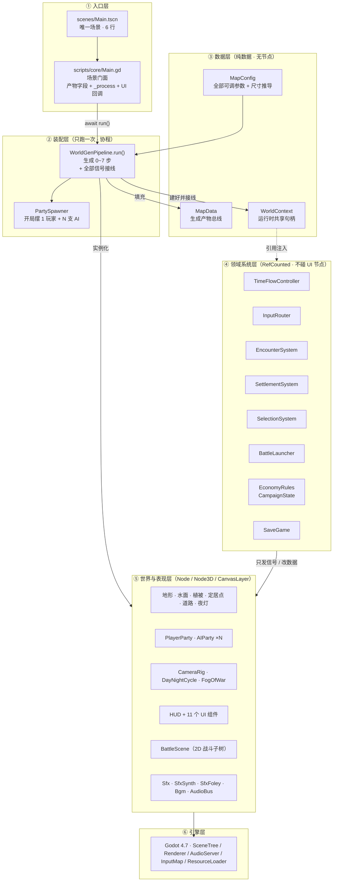

### 3.1 每层职责与「谁能调谁」

| 层 | 允许做的事 | **禁止**做的事 |
|---|---|---|
| ① 入口层 `Main.gd` | 装配产物字段、按固定顺序跑帧、把 UI 信号转成业务调用 | 不要在 `Main` 里写生成算法或玩法公式（已全部搬出去了） |
| ② 装配层 `WorldGenPipeline` | 调用各生成器、`add_child` 进场景树、连信号、建系统对象 | **不要改变生成顺序**（= 指纹），不要在生成期抽 `randi()` 全局随机 |
| ③ 数据层 | `MapConfig` 存参数并做尺寸推导；`MapData` 存结果；`WorldContext` 存引用 | `MapData` 不要持系统对象；`WorldContext` **不要反向持有系统**（会形成引用环） |
| ④ 领域系统层 | 判断规则、维护状态、发信号、返回纯数据（条目数组 / report 字典） | 不要 `get_node` 去碰 UI 控件、不要 `queue_redraw`、不要弹提示条 |
| ⑤ 表现层 | 建节点、画东西、播音、做动画、接收数据并显示 | 不要反过来修改规则数值（要改就发信号给 ④） |
| ⑥ 引擎层 | — | — |

**为什么这条分层不是教条**：④ 层之所以完全不碰 UI，是为了让 `tools/*_check.gd` 能在
`--headless`（没有窗口、没有渲染、没有场景）下把「买粮 / 招兵 / 遭遇结算 / 存档校验」整条跑一遍并断言。
这是本工程 60–80 秒门禁能覆盖这么多逻辑的根本原因。**破坏这条分层 = 让门禁失效。**

---

## 4. 启动与生成流水线

### 4.1 时序

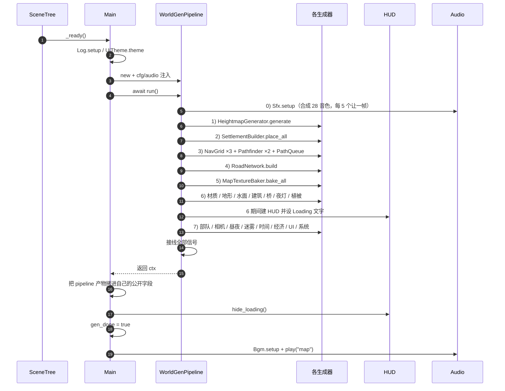

每个 `await _loading("文字…")` 会让出**两帧**，所以 Loading 遮罩的进度文字会真的动起来。
`_loading()` 的**调用顺序与次数也是指纹的一部分**，别合并、别重排。

生成耗时参考：1024 m 门禁图约 **3 秒**（含音效合成 ≈1.6 s）；4096 m 出货图约 **83 秒**（见 ROADMAP §16.4）。

### 4.2 七个阶段各产出什么

| 步 | 阶段 | 产出写进 | 关键类 |
|---|---|---|---|
| 0 | 音效合成 | `Sfx` 静态音色库（可选命中 `user://sfx_cache`） | `Sfx` / `SfxSynth` / `SfxCache` / `SfxFoley` |
| 1 | 高度场 | `data.hm`（Heightmap）、`data.gen`（生物群系/森林遮罩/河湖/浅滩） | `HeightmapGenerator` |
| 2 | 定居点选址 | `data.settlements`（18 座：每势力 1 王都 + 2 城镇 + 3 村庄） | `SettlementBuilder.place_all` |
| 3 | 寻路栅格 | `data.nav_fine/coarse/road`、`data.path_fine/coarse`、`data.path_queue` | `NavGrid` / `Pathfinder` / `PathQueue` |
| 4 | 道路网 | `data.roads`（21 条）、`data.bridges`（7 座） | `RoadNetwork` |
| 5 | 烘焙贴图 | `data.splat_texture` / `height_texture` / `minimap_texture` / `data.territory` | `MapTextureBaker` |
| 6 | 材质与网格 | 4 个 ShaderMaterial + 地形分块 + 水面 + 建筑 + 夜灯 + 植被实例 | `MaterialFactory` / `TerrainManager` / `WaterBuilder` / `SettlementBuilder.build_all` / `VegetationScatter` |
| 7 | 部队与外围 | `player`、`parties`、`camera_rig`、`day_night`、`fog`、`hud`、`view`、`hover`、`time`、`rules`、`economy`、`campaign`、`ctx`、`encounters`、`settlements`、`battler`、`picker`、`selection` | `PartySpawner` / `CameraRig` / `DayNightCycle` / `FogOfWar` / `HUD` / `OverworldView` / `HoverInspector` / 各系统 |

### 4.3 「host 契约」——`WorldGenPipeline` 与 `Main` 的接口

`WorldGenPipeline.run()` 结束后，`Main` 上**保证已就位**的字段（`Main` 从 `pipeline` 逐个拷过来）：

```
data  hud  player  ai_parties  day_night  camera_rig  router  vegetation  fog
view  hover  time  rules  economy  campaign  encounters  settlements
battler  picker  selection  ctx
```

**这些字段名就是场景的对外接口**：`tools/` 下的脚本与各系统都按名字取。改名会牵动一圈，
所以要改就全局搜一遍再改（`grep -rn "\.camera_rig\|\.ai_parties" tools/`）。

### 4.4 ⚠ 「生成顺序 = 指纹」这条约束

- 所有随机数都来自 `cfg.make_rng("标签")`（`MapConfig.make_rng` 用 `map_seed + 标签哈希` 播种），
  每个阶段一条**独立流**。
- 因此：**同一阶段内「先抽什么、后抽什么」决定结果**。在 `HeightmapGenerator` / `SettlementBuilder` /
  `RoadNetwork` / `VegetationScatter` 里插入、删除、交换任何一次随机抽取，都会改变整张地图。
- 一旦变了，`tools/gen_fingerprint.gd` 的指纹与 `gen_fingerprint.json` 基线不再相等 → **门禁第 2 步直接红**。
  这是**故意的**：它逼你显式承认「我改了世界生成」，并重新评估所有依赖旧世界坐标的东西
  （尤其是 `tools/perf_baseline.json` 与 `scale_baseline.json`）。
- 例外（安全）：**在生成结束之后**建对象、连信号、算纯算术（例如第七轮的 `MapPicker` / `SelectionSystem`
  那一段）—— 它们不抽随机数，所以逐位不变。

---

## 5. 每帧主循环（`Main._process`）

**这是最容易被新人改坏的地方**：顺序本身承载语义（例如「玩家先走，停下那一帧立刻冻结世界」）。

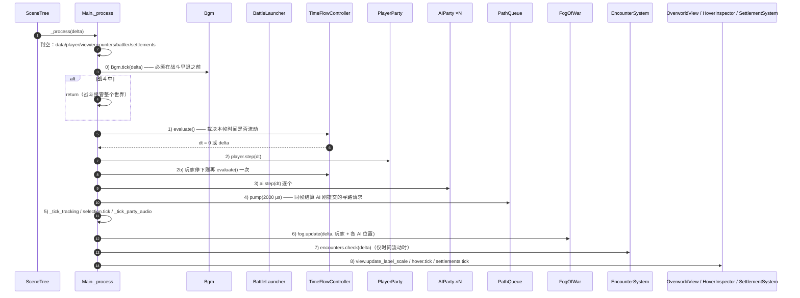

几个「为什么」：

- **0) `Bgm.tick` 在早退之前**：否则进战斗后音乐永远切不过去。
- **1) 先 `evaluate()`**：`dt` 不是 `delta`，而是「世界时间是否流动」的结果。暂停时 `dt = 0`，
  于是所有 `step(0)` 都变成空转，不需要在每个 `step` 里各判一次暂停。
- **2) 玩家先走再复判**：玩家抵达目标的**那一帧**就冻结世界，AI / 遭遇 / 昼夜都不再推进。
- **4) 队列在 AI 之后**：AI 在 `step()` 里提交请求，同帧 `pump()` 结算，低负载下与同步寻路几乎无差。
- **7) 遭遇只在时间流动时检测**：暂停时你不会「撞上」别人。
- **迷雾不受 `dt` 影响**：它是纯视觉，暂停时也继续揭开（用的是 `delta`）。
- **`_tick_party_audio(dt)` 用 `dt`**：世界时间暂停时马蹄声自动静音。

---

## 6. 数据层：`MapData`（产物总线）与 `WorldContext`（共享句柄）

### 6.1 分工

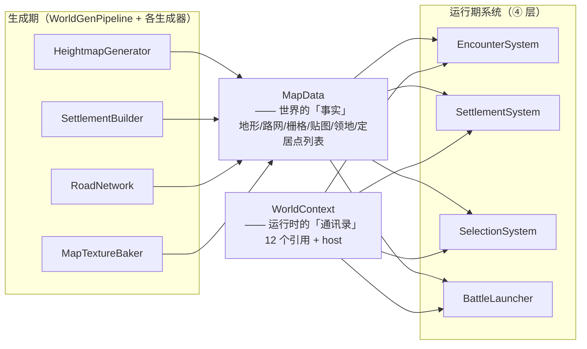

- **`MapData` = 「世界是什么样」**（地形高度、生物群系、栅格、路网、贴图、定居点、势力）。
  只存**数据**，不存系统对象。由生成期填满，运行期只读（除 `fog` / `territory` 等少量可变项）。
- **`WorldContext` = 「找谁办什么事」**（host / cfg / audio / data / hud / camera / router / time /
  rules / view / day_night / player / parties / economy / campaign）。运行期系统通过它拿引用。

### 6.2 ⚠ 引用环禁令（一个真实踩过的坑）

`WorldContext` 只放**单向引用**。**绝对不要**在 `ctx` 里加反向字段，例如 `ctx.settlements = settlements`：
`SettlementSystem.ctx` 已经持有 `ctx`，再互持就构成 `RefCounted` **引用环**，两个对象的引用计数永不归零，
表现为进程退出时：

```
ERROR: N resources still in use at exit
```

而门禁对 `ERROR:` 零容忍 → 所有「建世界」的步骤一起变红（实测踩了 6 步）。
需要 `settlements` 的地方（`Main` / 工具脚本）直接读 `pipeline.settlements`。

### 6.3 `MapData` 字段速查

| 分类 | 字段 |
|---|---|
| 生成产物 | `hm`（Heightmap）、`gen`（生物群系遮罩等） |
| 世界内容 | `factions`、`settlements`、`roads`、`bridges` |
| 导航 | `nav_fine`（4 m）、`nav_coarse`（8 m）、`nav_road`（8 m，河流可通行） |
| 寻路器 | `path_fine`、`path_coarse`、`path_queue` |
| 贴图 | `splat_texture`（512² RGBA：R 道路 G 沙漠 B 岩石 A 湿度）、`height_texture`（RF）、`minimap_image` / `minimap_texture`（256²） |
| 领地 | `territory`（`PackedByteArray`，`TERR_RES = 128`，`territory_cell = map_size/(res-1)`；255 = 水域/无主） |
| 查询助手 | `height_at` / `normal_at` / `slope_at` / `is_water` / `faction` / `faction_at` / `nearest_settlement` / `settlements_of` / `settlements_of_kind` |

### 6.4 `MapConfig`：参数 + 尺寸推导

- 所有可调数值都是 `@export`，能在检查器里调。
- **绝对米数不许写死**：一律用文件末尾的推导函数，参照 `SIZE_REF = 1024.0`（旧世界 = 1×）：

| 函数 | 语义 | 1024 m | 4096 m |
|---|---|---|---|
| `size_scale()` | 线性倍率 | 1.0 | 4.0 |
| `area_scale()` | 面积倍率 | 1.0 | 16.0 |
| `scaled_heightmap_res()` | 高度图分辨率（与地形网格同分辨率） | 513（2 m 间距） | 1025（4 m 间距） |
| `river_half_width()` | 河道半宽 | 11 m | 44 m |
| `fords_per_river()` | 每条河的渡口数 | 2 | 8 |
| `lake_radius_m()` / `min_settlement_distance_m()` / `flatten_radius_m()` | 湖泊半径 / 定居点最小间距 / 地基平整半径 | 基准 | ×4 |
| `cam_*_height_m()` / `cam_pan_speed_m()` / `strategic_view_height_m()` | 相机与雾、视野的「能看多远」 | 基准 | ×4 |
| `party_count()` | AI 部队总数（**遭遇率曲线，不是几何量**） | 14 | 100（幂律插值，指数 1.42） |

**速度不放大**（`player_speed` / `ai_speed` / `encounter_distance` 保持绝对值）：
横穿 4096 m 要 89 秒（旧世界 22 秒）—— 这是「地图更大」的手感，不是「人更快」。

环境变量覆盖（**门禁靠这个把世界压回 1024 m**，不必为测试另存配置）：

```powershell
$env:WARBAND_MAP_SIZE = "1024"   # 覆盖 map_size 并按尺寸重算 heightmap_res
$env:WARBAND_HM_RES   = "513"    # 再单独覆盖高度图分辨率（可选）
```

---

## 7. 领域系统详解

### 7.1 时间流动状态机 `TimeFlowController`

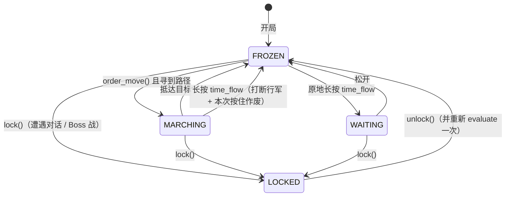

四条规则（原样保留自拆分前）：松开清标记 / 行军途中按下即中断 / 停下后长按才流动 / 锁定时空格无效。
派生量：`game_paused`（UI 只读它）、`state`（调试）。
流速 `speed_steps = [1, 2, 4]`，`cycle_speed()` 循环切换并把倍率推给 `DayNightCycle.speed`。

**注意**：`time_lock` 不要当开关直接赋值，走 `lock()` / `unlock()`（Boss 战结束还要重新 `evaluate()`）。

### 7.2 输入路由 `InputRouter`（图：动作 → 语义信号）

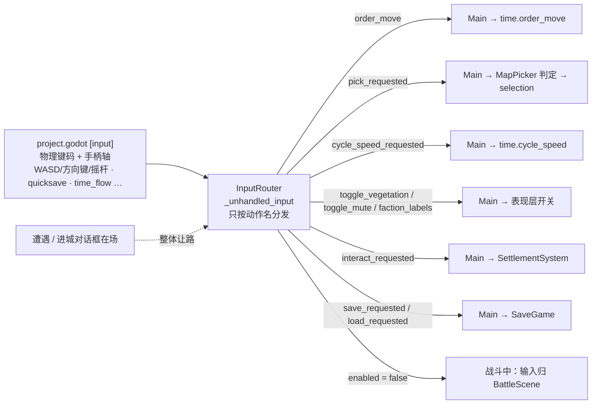

要点：

- **键码只出现在 `project.godot` 里**。加手柄、改键位不必动代码。
- **左键有两条互斥出口**：先经 `MapPicker` 判命中 → 点到实体发 `pick_requested`（选中），
  点空地才发 `order_move`（行军）。`picker == null` 时行为与「没有拾取功能」逐位一致
  （`tools/input_check.gd` 里不建世界的那条自检走的就是这条路，所以 `picker` 不能改成必填）。
- **存/读档刻意不经过「对话框让路」那道闸**：面板状态不进存档，所以「能不能存」由业务层判并给出理由，
  而不是按了没反应。
- 遭遇 / 进城对话框打开时，路由整体让路（键盘要先留给对话框作答）。

### 7.3 遭遇 → Boss 战 → 结算

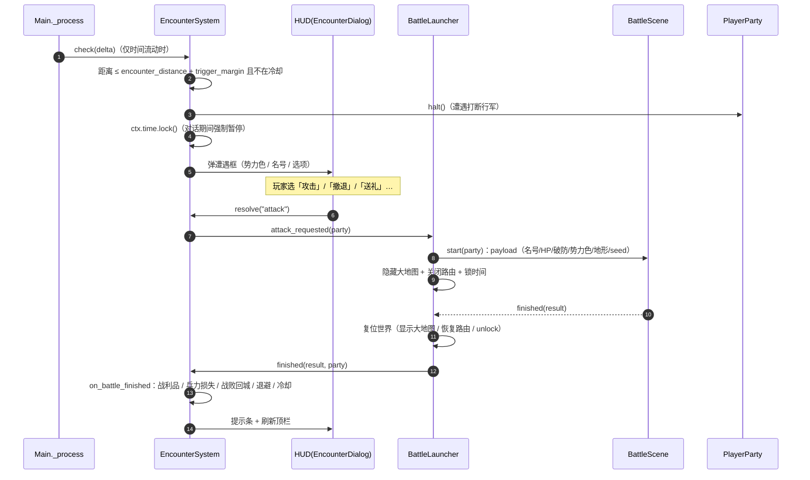

`EncounterSystem` 与 `BattleLauncher` **互相回调**，所以用**信号断开环**：
`encounters.attack_requested → battler.start`，`battler.finished → encounters.on_battle_finished`。
分工：`EncounterSystem` 决定「要不要开打」并做结算；`BattleLauncher` 只管战斗场景的生命周期与进出场。

数值全在 `EncounterRules`（Boss HP / 破防 / 各冷却 / 退避距离 / 战利品与损失率）。
三类头目（领主 / 强盗头目 / 商队护卫长）共用同一个 Boss 状态机，差异只在招式表、体型、配色、系数。
`EncounterSystem.last_ledger` 是显式记账的伤亡/收支台账（给自检断言用）。

### 7.4 进城与战役经济

```mermaid
flowchart TB
    ROUTER["InputRouter.interact_requested"] --> SYS["SettlementSystem"]
    TICK["每 0.5 s：tick() 看玩家脚下"] --> SYS
    SYS -->|nearby() 命中| HINT["HUD 提示条：按 X 进城"]
    SYS -->|open()| LOCK["time.lock() + camera.set_camera_active(false)"]
    SYS -->|menu_entries()| HUD["HUD SettlementDialog<br/>只照着画，不判断谁能做什么"]
    HUD -->|settlement_action| SYS
    SYS -->|resolve(action)| ECON["CampaignState<br/>所有收支都走这里"]
    SYS -->|close()| UNLOCK["解锁时间 + 把地图操作还给玩家"]
    DAY["DayNightCycle.day_changed"] -->|日结| ECON
    DAY -->|志愿者回流| SYS
    ECON -->|day_settled / week_settled| MAIN["Main._on_day_settled<br/>print + 只在出事时弹提示"]
```

- `GameState` = **开局常量**（`START_DENARS=400` / `START_SUPPLIES=35` / `START_MORALE=50` /
  `START_RENOWN=120` / `PLAYER_START_TROOPS=37`）；`CampaignState` = **一局里会变的那份**（会被存档）。
- 换日结算挂在 `day_changed` 上，**不在 `_process` 里判「今天结过没有」**：时间流速 / 暂停 /
  Boss 战锁时间全都自动正确。
- 繁荣度 / 志愿者池 / 货物本地价差由 `SettlementSystem.assign_environment()` 在生成期用
  **独立随机流** `make_rng("settlement_economy")` 一次定下来 —— 不消耗主生成流、不改生成顺序。
- 公式与出处逐条标注在 `EconomyRules` 头部（外部骑砍反编译文档的三级证据：实证 / 推断 / 未解；
  本地化映射逐处标「本地化」）。

### 7.5 点单位交互（第七轮）

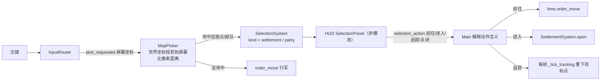

`MapPicker` 刻意**不用 3D 射线 + 碰撞体**（大地图上一个碰撞体都没有，给每个实体加
`CollisionShape3D` 等于把物理世界与每帧同步开销一起引进来）。
它把实体世界半径用同一个投影换算成像素作为命中阈值，再钳到 `[14, 90] px`；
部队阈值 ×0.85，且在两支都命中时给部队 `PARTY_ADVANTAGE_PX = 6` 的让先
（因为领主 AI 会站在城里，否则永远点不动）。它是**纯只读**的，投影三步被抽成可覆写方法，
自检用 `StubPicker` 免渲染窗口。

`SelectionSystem` 与 `SettlementSystem` 的 `current` **刻意分开**：看详情不该把世界时间锁上。
`SelectionPanel` 因此**不进** `is_any_dialog_open()`。

### 7.6 存档 / 读档 `SaveGame`

设计取舍（详见文件头）：

1. **不存地图**：只记 `map_seed`，读档 = 重建世界（6~7 秒）+ 套状态。
2. **实体靠稳定 id 对齐**：定居点用 `Settlement.id`，部队用 `AIParty.spawn_id`（生成顺序序号）。
   **不能**用数组下标 —— 打赢一场 Boss 战会 `ctx.parties.erase()`，下标全体错位。
3. **面板状态不存**：读档时 `apply()` 的「修引用」步骤会把遭遇框 / 进城菜单收起来。
4. **AI 内部计时不存**（重寻路 / 追击 / 失败退避 / 游荡锚点）。
5. **读档不重跑日结**：`day` 只写回，绝不触发 `day_changed`（否则读一次档 = 过一天，扣粮发薪算逃兵）。

格式门槛：`MAGIC` + `SAVE_VERSION`（=1）+ `map_seed` + 定居点数量 / 部队 id 身份校验，
**任一不合就拒绝读档**（宁可拒绝，不可猜）。每个字段**先钳再写**，钳掉了什么记进 `warnings`。

### 7.7 世界生成子系统

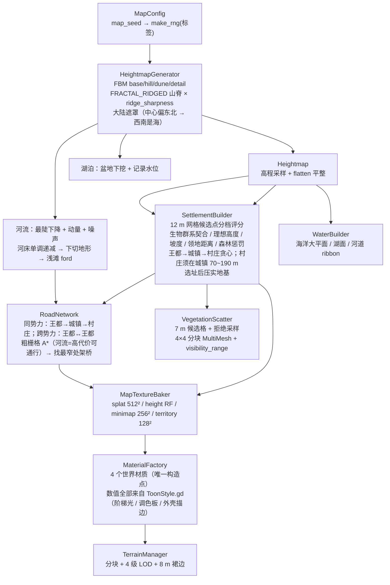

关键常量与「为什么」（都写在各自文件头）：

| 主题 | 要点 |
|---|---|
| 地形网格 | 分块 `max(128, map_size/16)` 米；每块 `LOD_QUADS=[32,16,8,4]` 随尺寸等比放大，**顶点间距恒为 4 m**；LOD 距离 `[220, 400, 660, ∞]`；四周 8 m 裙边遮缝 |
| 植被 | 候选格 `CELL=7.0` **绝对值不变**（保持「每平方公里多少棵」的密度属性）；每类分 4×4 块，`cast_shadow=OFF`，远处整块消失，战略视图直接隐藏根节点 |
| 材质 | `MaterialFactory` 是 4 个世界材质的**唯一构造点**，所有数值（三档阶梯 / 9 色 / 描边宽度 / 面着色）取自 `ToonStyle.gd`；旧版的 2 张无缝细节贴图已在 ⑮ 删除 —— 微缩沙盒的质感来自大色块 + 硬光影 + 干净轮廓，颗粒贴图只会把它拉回写实 |
| 夜灯 | 只有城堡 / 城镇点灯（村庄不点）；能量由 `DayNightCycle` 按夜色推 |
| 建筑 | 程序化几何（`MeshKit` 方块/棱柱/圆锥，顶点 alpha 约定 0=建材 / 1=窗（夜里自发光）/ 0.5=旗帜（风动））+ **村庄部分换成外部 GLB** |
| 外部模型 | `AssetManifest`（要什么 / 应该多大 / 三角形数）+ `ModelLibrary`（加载 / 缓存 / **尺度推导** / 接地偏移）。尺度 = `target_m ÷ 几何实测 AABB 高度`，不是手抄倍率；加载失败**返回 null 让调用方整套回退程序化几何**，且先用 `ResourceLoader.exists` 再 load，避免一次回退就在门禁刷出 ERROR |

### 7.8 寻路与 AI

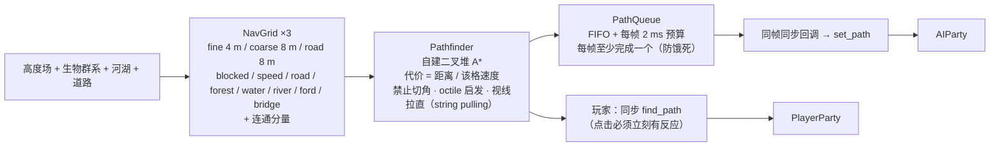

- **地形速度**：道路 1.2 / 草地 1.0 / 森林 0.7 / 山地 0.5 / 雪地 0.4（优先级：道路 > 雪地 > 山地 > 森林 > 草地）。
- **不可通行**：海洋 / 湖泊 / 河流（渡口 `ford` 与桥 `bridge` 除外）。
- **`PathQueue` 的契约**（`tools/path_queue_check.gd` 逐条验证）：结果与同步 `find_path` **逐点相同**；
  严格 FIFO；每请求恰好完成一次；单帧 ≤ 预算（例外只有「这一帧只做了一个、而它本身就超预算」）。
  排队只改「什么时候算」，不改「算出什么」，也不动任何一条抽签序列。
- **三种 AI**：领主在本势力定居点间巡逻（优先王都→城镇→村庄，**会站在城里**）／商队在城镇间往返
  （道路代价低 → 自然走官道）／强盗野外游荡，玩家进入 `vision` 后追击。
- 每支部队有自己的 `rng`（`hash(spawn_id + "|ai")`）与错开的重寻路间隔；
  **`PartySpawner` 的调用顺序是生成指纹的一部分**（下标取自 `ai_parties.size()`，谁先被造出来会改变后继部队的名字与视野）。

### 7.9 音频子系统

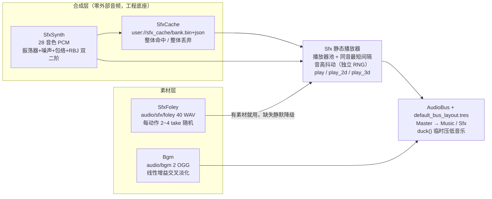

四条硬约束（都写在文件头，别绕过）：

1. **合成/缓存的随机数不共用**：音高抖动、录音变体各用**独立固定种子 RNG**。合成消耗多少随机数是实现细节
   （命中 PCM 缓存时一次都不消耗），共用会让「冷启动」与「命中缓存」两条路径听感不同。
2. **缓存整体命中 / 整体丢弃**，不做单曲补合成 —— 噪声类音色共用一条 RNG 流，跳过任何一个都会改变后面所有音色。
3. **缓存坏了是正常情况**：校验不过就静默丢弃走冷启动，**绝不 `push_error` / 绝不打 `ERROR` 行**（门禁零容忍）。
4. **缓存键覆盖合成算法的全部输入**，包括 `SfxSynth.gd` **自身的文件字节指纹**（改了合成代码忘 bump `FORMAT` 也能自动失效）。

降级策略：素材缺失只 `push_warning`；找不到总线退回 `Master`。`M` 键一次同时关掉音效与音乐
（`Bgm` 不另存静音状态，直接读 `Sfx.is_muted()`）。

> 两个高频坑：`SfxSynth` 与 `SfxFoley` 都**刻意用 `CACHE_MODE_IGNORE`** 加载 —— 走全局资源缓存的话引擎收尾时
> 缓存还钉着这些流，headless 跑主场景会报 `ERROR: N resources still in use at exit`。

### 7.10 Boss 战子系统

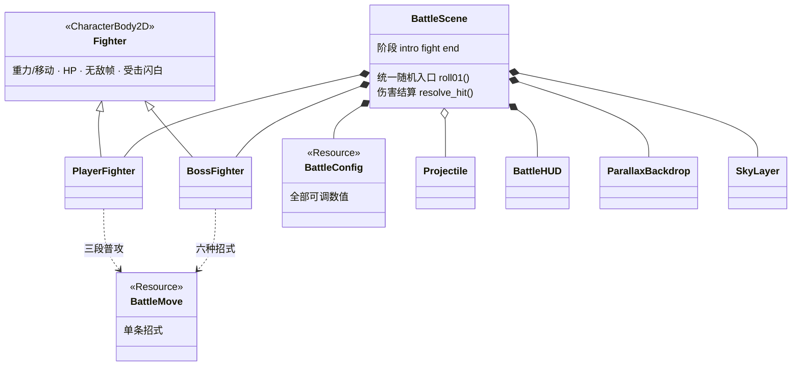

- **场景结构**：`CanvasLayer(-5)` 天空 → `Node2D(self)` 视差背景 + 竞技场（地面/平台/雾墙自绘）
  + 玩家/Boss/投射物/特效 → `CanvasLayer(10)` 战斗 HUD → `Camera2D` 水平跟随 + 按双方距离拉缩放。
- **两个状态机**：玩家 14 态（`IDLE…DEAD`），Boss 7 态（`IDLE/APPROACH/MOVE/STAGGERED/BROKEN/PHASE2/DEAD`）。
- **统一随机入口**：战斗内必须走 `BattleScene.roll01()`，**不要用全局 `randf()`** ——
  全局 RNG 每次进程启动都重新播种，会让战斗不可复现（`sfx_battle_check` 曾因此 4 次里偶发 1 次 FAIL）。
- **判定**：`Hitbox` / `Hurtbox` 分层 Area2D，只在判定帧打开 `monitoring`；
  每次攻击对同一目标只结算一次（`hit_this_attack`）。
- **数据连接**：进场传玩家部队名/兵力/地形类型/Boss 名号与数值/势力色/seed；
  胜利 → 该部队从地图消失；失败 → 送回最近的己方或中立城镇并推进半天；撤退 → 原样返回。
- 外部资料引用 `G:\warband_docs` **不在本仓库内**（那是原开发机上的骑砍反编译文档）。

---

## 8. 渲染与着色器层

| Shader | 作用 | 主要 uniform |
|---|---|---|
| `terrain.gdshader` | 地形：splat 混合 + 细节反照率/法线 + 昼夜 + 迷雾 + 地面自发光「地板」 | `detail`/`normal` 贴图、`night_amount`、`day_amount`、`fog_map`/`fog_enabled` |
| `water.gdshader` | 海水/湖水/河水：顶点波动 + 菲涅尔 + 按水深染色 + 岸边泡沫 | `height_texture`（求水深）、`night_amount` |
| `vegetation.gdshader` | 植被顶点风动 + 昼夜 + 迷雾 | `night_amount`、`fog_map` |
| `settlement.gdshader` | 程序化建筑：顶点 alpha 通道约定（1=窗自发光、0.5=旗帜风动） | `night_glow`、`fog_map` |
| `settlement_model.gdshader` | 外部 GLB 建筑（与上面**逐字对齐**的迷雾语义） | `night_glow`、`fog_map`/`fog_enabled`/`map_size` |
| `sky_clouds.gdshader` | 程序化天空 + 白云，按太阳高度角在四套配色间插值 | `SKY_CONSTANTS`（GDScript 显式设一遍） |
| `toon_outline.gdshader` | 反向外壳描边（`cull_front` + `unshaded`，沿**平滑法线**膨胀） | 由 `ToonStyle.attach_outline()` 挂到闭合几何的 `next_pass` |

三条约定：

1. **材质只有一个构造点**：`MaterialFactory`（`build()` 产 4 个世界材质 + `model_materials()` 给 GLB）。
   改材质参数请只改这里。
2. **昼夜 / 迷雾靠注册制注入**：`DayNightCycle.register_shader(mat, "night_amount")`、
   `fog.set_shader_parameter(...)`。`WorldGenPipeline` 会**逐个**把
   `terrain_mat / water.mats / vegetation_mat / settlement_mat / party_mat / model_materials()` 接进去 ——
   **漏一个不会报错、不会崩、指纹也不变，但夜里那一类物体不跟着变暗**（像一堆灯塔）。
3. **天空常量由 GDScript 显式设一遍**：`get_shader_parameter` 对「从未被赋值过」的 uniform 返回 `null`，
   自检读回来会以为参数丢了；`cloud_speed` 必须是 0，云一动就每帧重算天空辐照度，
   而环境光取自天空 → 整个场景漫反射在抖。
4. **NPR 的数值只有一个来源**：`scripts/world/ToonStyle.gd`（阶梯 3 档 / 64×1 梯度图 / 9 色调色板 /
   描边宽度与墨色）。shader 里的 `uniform ... = vec3(...)` 只是默认值，真正生效的是 `MaterialFactory`
   逐条写进去的 `ToonStyle.C_*`；改配色必须两处一起改，`tools/visual_check.gd` 会逐条比对。

---

## 9. UI 层

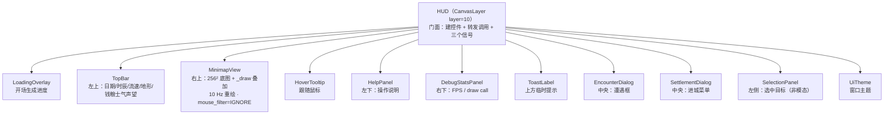

- **HUD 只跟 `Main` 的公开方法打交道**，接口与拆分前完全一致，改动对外无感。
- **每块控件自己 `_process`**，HUD 不再需要每帧回调。
- **`mouse_filter` 是硬约定**：纯展示控件（小地图、提示条）必须 `MOUSE_FILTER_IGNORE`，
  否则右上角约 332×348 区域的左键会被吃掉，「点地行军」在该区域完全失效。
- UI 文案已全部迁进 `Strings`（常量名 `SCREAMING_SNAKE`，带格式符的由调用点自己 `% [...]`）；
  `tools/i18n_check.gd` 用棘轮数字钉着 `ui_total = 0`，往后只许保持 0。

---

## 10. 质量保障体系（三道安全网）

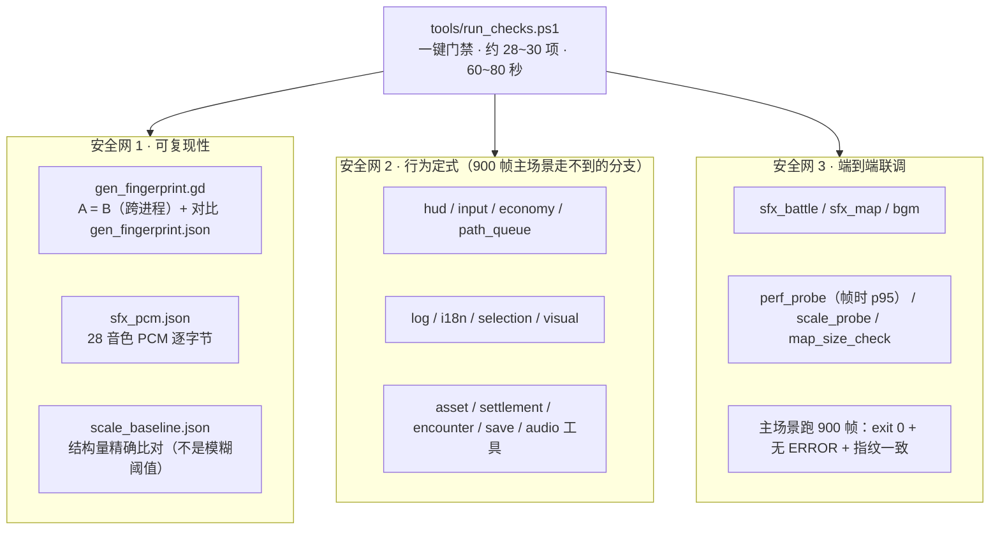

### 10.1 三个基线文件（都在 `tools/`，都是**产物**但**要提交**）

| 文件 | 钉住什么 | 关键值 |
|---|---|---|
| `gen_fingerprint.json` | 世界生成的 SHA-256 指纹 + 各分项哈希 | `958433c2f04c0e39…`（1024 m）；settlements 18 / bridges 7 / vegetation 5150 |
| `perf_baseline.json` | 帧时间 | `frame_ms` avg 1.5 / p95 1.8（带容差） |
| `scale_baseline.json` | 规模结构量 | 精确比对，不给模糊阈值 |

**什么时候该更新基线**：只有当你**有意识地**改变了它钉住的东西（换了生成算法、换了世界尺寸）。
更新必须单独成一步、单独说明理由，并连带复核其它依赖旧数值的工具
（`ROADMAP §17` 有「一次性再基线化」的既有先例 —— 第③批-3 城镇/城堡换真模型时就做过一次）。

### 10.2 门禁步骤一览（编号与 `run_checks.ps1` 头注释一致）

| 编号 | 内容 |
|---|---|
| 1 / 2 / 2b | 生成指纹 A=B（跨进程可复现）→ 与 `gen_fingerprint.json` 基线比对 |
| 3 | HUD 冒烟 |
| 4 | 输入层（含「不建世界」的纯路由路径） |
| 5 / 5b / 5c / 5d / 5e / 5f / 5g | 经济 / 寻路队列 / 日志 / i18n / 拾取 / 观感 / 资产 |
| 6 / 6b / 6c / 6d | 定居点 / 遭遇 / 存档 / 选择 |
| 7 / 7b / 7c | 音效（地图侧 / 战斗侧 / PCM 逐字节） |
| 7d | **可选**：`WARBAND_BIG_MAP=1` 时的大地图探针 |
| 8 | 主场景 900 帧端到端 |
| 9 / 9b / 9c / 9d / 9e | BGM / 拟音 / 帧时间 / 规模 / 地图尺寸 |
| 10 | 汇总与退出码 |

**门禁的硬规矩**：

- **`ERROR:` / `SCRIPT ERROR` / `Parse Error` 零容忍**（大小写敏感地断言）。
  注意 Godot 的 stderr 会被 PS 5.1 变成 `NativeCommandError`（**假失败**），所以只断言上面三种大小写精确的串。
- 默认 `WARBAND_MAP_SIZE=1024`（小图跑得快）；`GODOT_BIN` 环境变量可覆盖引擎路径，
  默认 `G:\godot_project\_godotengine\Godot_v4.7-stable_win64_console.exe`。
- 每步 180 秒超时，日志写到 `%TEMP%\warband_check_*.log`。
- **只支持 Windows PowerShell 5.1**。用 pwsh 7 或（更糟）把 `.ps1` 存成无 BOM 会直接炸。

### 10.3 CI

`.github/workflows/ci.yml`：`windows-latest` → 下载固定 URL 的 `Godot_v4.7-stable_win64.exe.zip`
→ `--headless --editor --quit` 建 `global_script_class_cache.cfg` → 跑 `run_checks.ps1` → 失败上传日志。

> ⚠ 这套 CI **从未在真 runner 上跑过**（仓库只有本地门禁的实测记录）。第一次开启 Actions 时需要预留排错时间。

### 10.4 已知的「无害噪音」（别当 bug 追）

- headless 退出时的 `ObjectDB` / `resources still in use at exit` 类警告（`CACHE_MODE_IGNORE` 已处理音频那部分）。
- `sfx_battle_check` 的播放次数在 **54–62** 之间浮动（战斗时长与 AI 决策有关）。
- headless 下 `draw_calls` 恒为 0（dummy 驱动）。
- `icon.svg.import` 会显示成幽灵般的 ` M`（编辑器伪修改）。
- 尚未被自检覆盖的音色：`battle_start` / `parry_reflect` / `result_lose` / `ui_back`；`proj_impact` 当前无使用点。

---

## 11. 关键不变量（交接必读）

> 这 12 条是本项目最贵的经验。违反任何一条，门禁会红、或者更糟：**不红但世界悄悄坏掉**。

| # | 不变量 | 违反了会怎样 |
|---|---|---|
| 1 | **不改生成期 RNG 抽取顺序**（`HeightmapGenerator` / `SettlementBuilder` / `RoadNetwork` / `VegetationScatter` / `PartySpawner`） | 生成指纹变，门禁第 2 步红；所有依赖旧坐标的基线一起失效 |
| 2 | **不在生成期抽全局随机**（`randi()` / `randf()` / `randi_range()`），一律用 `cfg.make_rng(标签)` | 同上，且不可复现 |
| 3 | **`WorldContext` 不反向持有系统**（引用环 → `RefCounted` 永不归零） | 退出时报 `ERROR: N resources still in use at exit`，门禁 6 步一起红 |
| 4 | **`ERROR:` 零容忍**：任何新代码不许在正常路径打 `ERROR` 行（包括「可回退的失败」） | 门禁全绿变全红；正确做法是静默降级 + `push_warning` |
| 5 | **`.ps1` 必须 UTF-8 带 BOM** | PS 5.1 按 GBK 解码 → 中文变乱码 + 语法错误 |
| 6 | **读 Godot 产出的 JSON 必须显式 `-Encoding UTF8`** | 基线被静默读成 `0/0/0` → 门禁**假绿**（最危险的一种） |
| 7 | **`tools/.gd` 改动要连带看基线**：改了生成算法 = 必须显式重新基线化并说明 | 门禁红，或者基线被随手改掉而没人知道变的是什么 |
| 8 | **战斗内随机走 `BattleScene.roll01()`**，不用全局 `randf()` | 战斗不可复现，`sfx_battle_check` 偶发 FAIL |
| 9 | **纯展示 UI 控件必须 `mouse_filter = IGNORE`** | 吃掉左键，「点地行军」在那一块区域完全失效 |
| 10 | **存档只按稳定 id 对齐**（`Settlement.id` / `AIParty.spawn_id`），不用数组下标 | 打赢一仗后地图实体全体错位 |
| 11 | **面板状态不进存档**；读档时 `day` 只写回不触发 `day_changed` | 读一次档 = 过一天（扣粮/发薪/算逃兵） |
| 12 | **④ 层系统不许碰 UI 节点**（不 `get_node` 控件、不弹提示、不播音效） | headless 自检失效 —— 这是 60 秒门禁能覆盖大量逻辑的前提 |

另外两条工程习惯：

- **日志一律走 `Log`**（`Log.info/warn/error`），文本自带 `[标签]` 前缀逐字保真。
  **但被工具解析的输出故意不走 `Log`**（例如 `Main` 的「地图生成完成」那一行），
  免得有人把日志级别调高就把门禁的解析对象一起静音了。
- **并行/交织改动不要卷进同一个提交**（仓库规则 G5）；本轮只 `git add` 本轮自己改的路径。

---

## 12. 改动菜谱（想做某件事，该去哪）

| 我想… | 去哪 | 注意 |
|---|---|---|
| 调平衡（Boss HP / 战利品 / 冷却） | `core/EncounterRules.gd` | 一张表，改完跑 `encounter_check` |
| 调经济（军费 / 士气 / 招募价 / 逃兵） | `core/EconomyRules.gd` | 头部逐条标了出处与「本地化」；跑 `economy_check` |
| 调战斗手感（HP/气力/招时序/顿帧） | `battle/BattleConfig.gd` + `battle/BattleMove.gd` | 都是 `@export`，可以存 `.tres` 后用检查器调 |
| 改地图长相（山高/雪线/河宽/植被密度） | `core/MapConfig.gd` | **会改指纹**；改完必须重新基线化并在提交信息里说明 |
| 换种子 | `MapConfig.map_seed` | 会改指纹；只能改基线，不能悄悄改 |
| 加一门新的世界生成阶段 | `core/WorldGenPipeline.gd` 插一步 + 在 `MapData` 加字段 | 顺序即指纹；阶段之间的 `await _loading()` 数量也别动 |
| 加一个新玩法系统 | 仿 `SettlementSystem` 的四件套：`open/menu_entries()/resolve()/close()` + `ctx` 注入 | 严守 §11 第 12 条；在 `WorldGenPipeline` 末尾接线，别抽随机数 |
| 加一个新按键 | `project.godot [input]` 加动作 + `InputRouter` 加语义信号 + `Main` 接 | **不要把键码写进脚本** |
| 加一个音色 | `audio/SfxSynth.gd` 的 `SPECS` + `_snd_*` 配方 | 改了合成代码要 bump `SfxCache.FORMAT`（`_script_stamp` 是第二道保险）；跑 `audio_check` / `sfx_pcm` |
| 换/加拟音素材 | 放 `audio/sfx/foley/` + 更新 `SfxFoley.SETS` 与 `CREDITS.md` | 响度要对齐它替换掉的合成音色，跑 `sfx_foley_check` |
| 换/加外部模型 | `world/AssetManifest.gd` 加条目（`path` / `target_m` / `tris`） | 尺度是**推导**出来的，别手抄倍率；跑 `asset_check` |
| 加一个 UI 面板 | `scripts/ui/` 新建组件 + `HUD` 里 `add_child` | 文案进 `Strings`（i18n 棘轮只许保持 0）；注意 `mouse_filter` |
| 改存档字段 | `core/SaveGame.gd` | 改格式要 bump `SAVE_VERSION`；新字段先钳再写；跑 `save_check` |

**每次改完的收尾动作**（本仓库规则 G1，硬性）：

```powershell
powershell -File tools/run_checks.ps1     # 必须全绿
git status --short ; git diff --stat
git add <本轮路径>
git commit -m "feat: …"                   # 中文，带前缀
# post-commit 钩子自动 push，确认输出里有 pushed 字样
git status -sb                            # 不应出现 ahead N
```

---

## 13. 现状与下一步

### 13.1 已完成（按 `docs/PORTING.md` 的批次）

| 批次 | 内容 | 状态 |
|---|---|---|
| — | 大地图基础：地形/水系/定居点/道路/寻路/AI 部队/相机/昼夜/迷雾/UI | ✅ |
| ① | 点单位交互（`MapPicker` + `SelectionSystem` + 面板） | ✅ `421042e` |
| ② | 观感提亮（环境光/细节贴图/地形 shader） | ✅ `fbd8488` |
| ③-1 | 资产管线（`AssetManifest` / `ModelLibrary` / `asset_check`） | ✅ |
| ③-2 | 村庄换真模型（GLB） | ✅ `03d75f0`（HEAD） |
| ③-3 | 城镇 / 城堡换真模型 + **一次性再基线化** | ⏸ 下一步 |
| ④ | 动作绑定 | ⏸ |
| ⑤ | 玩家面板 | ⏸ |
| ⑥ | 商店 / 菜单 / 存档 v2 | ⏸ |

### 13.2 已知未修的技术债

- **视觉债**：农田地块还是平的白色瓦片；GLB 不透明 → 夜里没有「窗户透光」效果。
- **规模债**：`Main.gd` 仍偏长（可继续搬）；`HUD.gd` 可再拆。
- **交互债**：键盘/手柄焦点导航没做（目前对话框主要靠鼠标）。
- **文档债**：`HANDOFF.md` 已过期；README 的代码统计数字过期（§2.1 给了实测值）。
- **CI 债**：`ci.yml` 从未在真 runner 上验证过。

---

## 附录 A：一图速记运行时对象关系

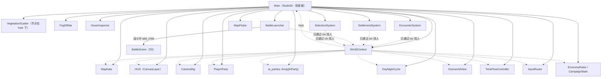

> 图中 **实线 = 直接持有**，**虚线 = 通过 `WorldContext` 间接引用**。
> 注意 `SettlementSystem` **不在** `ctx` 里（见 §6.2 引用环禁令）。

## 附录 B：术语对照

| 代码里的词 | 中文 | 说明 |
|---|---|---|
| `hm` | 高度场 | `Heightmap`，高程采样 + 查询（`height_at` / `slope_at`） |
| `gen` | 生成层 | 生物群系遮罩 / 森林遮罩 / 干旱度 / 碎石度 / 河湖浅滩标记 |
| `fine` / `coarse` | 细栅格 / 粗栅格 | 4 m（玩家）/ 8 m（AI） |
| `splat` | 地表混合图 | 512² RGBA：R 道路 G 沙漠 B 岩石 A 湿度 |
| `territory` | 领地归属 | 128² byte；255 = 水域/无主 |
| `ford` / `bridge` | 浅滩 / 桥 | 河流上两条可通行例外 |
| `party` | 部队 | 玩家或 AI 在地图上的行军单位（**不是**派对） |
| `lord` / `caravan` / `bandit` | 领主 / 商队 / 强盗 | `AIParty.Kind` |
| `spawn_id` | 生成序号 | 存档对齐实体用的稳定 id |
| `time_lock` | 时间锁 | 遭遇对话 / Boss 战强制暂停 |
| `roll01()` | 战斗随机入口 | 可复现；禁止全局 `randf()` |
| `fanfare` | 扇子音 | 号角/开战/结算类，播放时临时压低音乐 |
| `foley` | 拟音 | 脚步/马蹄/落地等录音素材层 |

